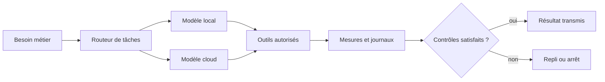

# Infrastructure

Une infrastructure personnelle conçue pour donner aux modèles d’IA un environnement mesuré, stable et réparable.

Ce dépôt est une vitrine publique volontairement minimale. Il décrit la direction du système sans publier les configurations, adresses, journaux, inventaires matériels ni procédures d’accès de l’installation exploitée.

## Ambition

Une IA ne devient pas plus utile en ajoutant seulement un modèle plus grand. Elle progresse quand son environnement sait :

- attribuer le bon niveau de calcul à chaque tâche ;
- mesurer la latence, la mémoire et les échecs ;
- isoler les services et limiter leurs droits ;
- conserver une solution de repli quand un fournisseur tombe ;
- documenter la reprise avant la panne.

## Ce que je cherche à améliorer

1. Plus de travail utile par gigaoctet de mémoire et par euro dépensé.
2. Des services observables avant d’être autonomes.
3. Des mises à jour testées dans un bac à sable avant promotion.
4. Des données qui restent dans la zone choisie par leur propriétaire.
5. Une installation qu’un autre opérateur peut reprendre.

## Frontière publique

Le dépôt exploité reste privé. Cette vitrine ne contient ni code de déploiement, ni inventaire réseau, ni configuration Docker, ni automatisation capable d’agir sur une machine réelle.

Voir aussi [MoltBot Hub](https://github.com/TimoLeDozo/MoltBot-Hub), la couche qui organise le travail des agents au-dessus de cette infrastructure.

## Auteur

Timothé Cagin, ingénieur diplômé ICAM  
[ICARUS](https://icarus-ia.fr) · [LinkedIn](https://www.linkedin.com/in/timoth%C3%A9-cagin-61a711225/)
