# Infrastructure

**Une boîte à outils qui reste au point, et un parc de logiciels libres tenu comme un atelier : inventorié, mesuré, noté, réparable.**

Ce dépôt est une **vitrine**. Il expose la méthode et les invariants, pas l'installation. Aucune adresse, aucun port, aucun nom d'hôte, aucune configuration exécutable n'y figure. Le dépôt exploité reste privé.

---

## En chiffres (octobre 2026)

| Mesure | Valeur |
|---|---|
| Outils indexés par le routeur (scripts, CLI, compétences, agents, serveurs MCP) | 607 |
| Sondes de santé, chacune capable d'échouer | 102 |
| Fichiers de tests automatisés | 242 |
| Modules notés sur 20, maison et tiers sur la même grille | 244 |
| Jours de veille technique ingérés et arbitrés | 66 |
| Décisions tracées, avec option par défaut et échéance | 345 |
| IA branchées sur le même outillage | 6 : Claude Opus, Claude Fable, Codex, Gemini, Qwen et Gemma en local, Hermes |

Ces chiffres sont relevés par les outils eux-mêmes, pas estimés. Le [journal](JOURNAL.md) date chaque étape.

---

## Le problème que je traite

Un poste de travail outillé accumule vite des centaines de scripts, de CLI, de conteneurs et de compétences. Passé un certain seuil, trois choses arrivent :

1. **On réécrit ce qui existe déjà.** C'est le gaspillage le plus courant. Le coût n'est pas d'écrire l'outil, c'est de ne pas savoir qu'il est là.
2. **On ne sait plus ce qui tourne.** Un job planifié rend `0` alors qu'il n'a rien fait. Une sonde affiche vert parce qu'elle ne peut pas rougir.
3. **On empile sans mesurer.** Un nouvel outil s'ajoute au lieu de remplacer, et personne ne compare.

Ce dépôt décrit comment j'y réponds.

---

## Vue d'ensemble

```mermaid
flowchart LR
    subgraph Entrer["Faire entrer"]
        V["Veille quotidienne"] --> SAS["Sas d'entrée"]
    end
    subgraph Tenir["Tenir"]
        R["Routeur d'outillage"]
        S["Sondes et objectifs de service"]
        REG["Registre des exécutions"]
    end
    subgraph Ameliorer["Améliorer"]
        CU["Relecture des sessions<br/>4 fois par semaine"]
        N["Note sur 20<br/>de chaque module"]
        NUIT["Missions de nuit<br/>en arbre jetable"]
    end
    SAS -->|VERT et reçu| R
    R --> REG --> S
    S -->|objectif rompu| NUIT
    CU --> N
    N -->|module faible| NUIT
    N -->|meilleur outil trouvé| SAS
    NUIT -->|fusion humaine| R

    style SAS fill:#2d2416,stroke:#b7986a
    style NUIT fill:#1a2b26,stroke:#6d9083
```

Trois mouvements, une seule règle : rien n'entre, ne reste ou ne change sans une mesure qu'un outil peut relire.

---

## Trois invariants

### 1. Un besoin en clair rend des outils, pas une recherche

Un routeur indexe l'outillage et répond à une phrase en français par une liste classée, avec la syntaxe d'invocation exacte. Il est branché sur **quatre assistants différents**. Le réflexe est le même quel que soit celui qui travaille.

Le classement est **mesuré, pas supposé**. Un banc d'essai rejoue des requêtes étalons et sort en échec si le rang attendu régresse.

### 2. Le planificateur déclenche, le registre décide

Un ordonnanceur système sait lancer une tâche. Il ne sait pas dire si elle a produit quelque chose. Un registre durable enregistre chaque exécution, sa sortie et sa preuve. C'est lui qui répond à « ce job a-t-il tourné, et qu'a-t-il fait ? ».

> Un incident réel derrière cette règle : un lanceur silencieux avalait la sortie de 18 tâches, dont le healthcheck. Tout était vert, rien n'était vérifié.

### 3. Une sonde qui ne peut pas échouer est refusée

Toute sonde ajoutée doit démontrer qu'elle sait rougir. On la casse volontairement (**test par mutation**). Si la suite reste verte, la sonde est rejetée. Un seuil posé à la valeur déjà cassée l'est aussi.

---

## Boucle d'auto-amélioration

Quatre fois par semaine, un agent relit les conversations des quatre derniers jours, critique les réponses données et cherche mieux sur le marché. Il ne s'auto-installe pas n'importe quoi : il suit le régime d'évolution.

```mermaid
flowchart TB
    J["Sessions des 4 derniers jours<br/>secrets masqués"] --> C["Critique :<br/>constat, preuve, correction"]
    C --> W["Recherche du meilleur outil<br/>sur le marché"]
    W --> SAS{"Sas d'entrée"}
    SAS -->|ROUGE| X["Écarté, motif tracé"]
    SAS -->|ORANGE| D["Décision humaine<br/>option par défaut à 48 h"]
    SAS -->|VERT| NOTE{"Note ≥ 16 / 20 ?"}
    NOTE -->|non| D
    NOTE -->|"oui, compétence ou extension"| I["Installé avec reçu"]
    C -->|défaut dans le code maison| A["Correctif en arbre jetable"]
    A --> F["Fusion humaine"]
    I & D & F --> RAP["Rapport daté<br/>et carte au tableau"]

    style X fill:#2b1a1a,stroke:#a05a5a
    style D fill:#2d2416,stroke:#b7986a
    style I fill:#1a2b26,stroke:#6d9083
```

Un serveur MCP, un environnement d'exécution ou un conteneur ne s'installent jamais seuls. Ils deviennent une décision, avec une recommandation, une échéance et un chemin de retour.

---

## Notation des modules : une grille, pas un feu tricolore

Un sas qui rend ORANGE presque tout ne dit plus rien. Chaque module, écrit ici ou venu de l'extérieur, reçoit une note sur 20 en quatre axes mesurés.

```mermaid
flowchart LR
    U["Usage<br/>sessions sur 30 jours<br/>0 à 5"] --> T(("Note<br/>sur 20"))
    F["Fiabilité<br/>sonde et tests<br/>0 à 5"] --> T
    S["Sécurité<br/>verdict du sas gradué<br/>0 à 5"] --> T
    V["Valeur<br/>face au marché<br/>0 à 5"] --> T
    T --> B1["VERT ≥ 15"]
    T --> B2["ORANGE 10 à 14"]
    T --> B3["ROUGE < 10"]

    style B1 fill:#1a2b26,stroke:#6d9083
    style B2 fill:#2d2416,stroke:#b7986a
    style B3 fill:#2b1a1a,stroke:#a05a5a
```

Trois règles rendent la grille juste :

1. **Le code maison n'a pas de bonus de confiance.** Tant que le sas ne l'a pas relu, il prend la même note de sécurité qu'un tiers réservé.
2. **Un module maison sans test ni usage plafonne à 9.** Écrire un outil ne suffit pas à le garder.
3. **Un ORANGE est gradué.** Les motifs de bruit (exemples de clés, installateur officiel) ne coûtent rien. Ceux qui touchent le poste (commande lancée à l'installation, identifiants lus, script téléchargé puis exécuté) retirent un point chacun.

Premier relevé complet, 244 modules :

| Origine | VERT | ORANGE | ROUGE |
|---|---|---|---|
| Maison | 45 | 29 | 27 |
| Services | 20 | 16 | 0 |
| Tiers | 8 | 65 | 34 |

Les 27 modules maison en ROUGE sont la liste de travail, pas une honte à cacher.

---

## Le régime d'évolution

Rien ne change au même rythme selon ce qu'on casse en se trompant.

| Palier | Contenu | Régime |
|---|---|---|
| **A** | Index d'outils, ré-indexation documentaire, dépendances de développement | Automatique la nuit, tests verts obligatoires |
| **B** | Images de conteneurs, dépendances d'exécution, serveurs MCP, modèles | Rapport automatique, **geste humain** pour appliquer |
| **C** | Agents en service, secrets, tout ce qui touche un hôte distant vivant | **Jamais automatique** |

Six règles encadrent l'ensemble :

1. Rien ne change sans une mesure avant et après, lisible par un outil.
2. Une capacité a **un titulaire**. Un remplaçant remplace, il ne s'ajoute pas.
3. Tout changement de palier B ou C dispose d'un **chemin de retour prouvé** avant d'être appliqué.
4. Le travail automatique se fait dans un arbre jetable, la fusion est humaine.
5. Une sonde qui ne peut pas échouer est refusée.
6. Un hôte distant en production n'est jamais muté par un script de nuit.

---

## Sécurité

La sécurité n'est pas une section en fin de document. C'est ce qui décide si un outil entre ou non.

### Sas d'entrée pour tout logiciel tiers

Aucun projet open source n'est déployé sur la foi de sa popularité. Il passe par un sas qui le clone **hors de l'arbre de travail** et l'inspecte :

```mermaid
flowchart LR
    T["Dépôt tiers"] --> C["Clone isolé"]
    C --> H["Hooks d'installation"]
    C --> M["Motifs d'exécution<br/>script téléchargé puis lancé"]
    C --> I["Injection, SQL"]
    C --> S["Secrets en clair"]
    C --> D["Images non épinglées<br/>et failles connues"]
    C --> K["Compétences d'agent<br/>scanner dédié"]
    H & M & I & S & D & K --> V{Verdict}
    V -->|propre| VERT["VERT : promotion possible"]
    V -->|réserves| ORANGE["ORANGE : note graduée,<br/>décision humaine"]
    V -->|hostile| ROUGE["ROUGE : refus"]

    style VERT fill:#1a2b26,stroke:#6d9083
    style ORANGE fill:#2d2416,stroke:#b7986a
    style ROUGE fill:#2b1a1a,stroke:#a05a5a
```

Un verdict ORANGE n'est pas un blocage. C'est un refus de décider à la place de l'opérateur.

### Contenu externe : traité comme hostile par défaut

Tout texte venu de l'extérieur (page web, courriel, message, document) passe par une **sentinelle d'injection** avant d'atteindre un modèle. Elle détecte l'injection de prompt, de SQL et les canaux cachés.

Deux principes non négociables :

- **Échec en position fermée.** Si la sentinelle ne peut pas s'exécuter, le contenu est mis en quarantaine. Une sentinelle injoignable ne prouve rien. La traiter comme un succès reviendrait à la désarmer en silence.
- **Le contenu tiers est cloisonné dans l'invite**, et les marqueurs de cloisonnement sont neutralisés dans ce contenu. Sans cela, il suffit d'écrire le marqueur de fermeture pour sortir de l'enclos et faire lire la suite comme une consigne.

### Surface d'exposition

- Les services écoutent en local. Ce qui doit circuler entre machines passe par un réseau privé maillé.
- Les images de conteneurs sont **épinglées par empreinte**, pas par étiquette mouvante. Une étiquette peut être redirigée, une empreinte non.
- Un digest épinglé n'est pas un digest approuvé. Le scan d'image et l'inventaire logiciel restent une étape distincte de la promotion.
- Les scouts web sont protégés contre le détournement vers des adresses internes.
- Une garde refuse toute suppression dans le dépôt sans geste humain.

### Secrets

- Aucun secret dans un fichier versionné. Les tests le vérifient : une clé nommée `token`, `password` ou `secret` fait rougir la suite, et une valeur de forme reconnaissable aussi.
- Nommer une variable d'environnement est légitime. Porter sa valeur ne l'est pas.
- Un scanner de secrets tourne avant chaque commit et chaque clôture de session, avec un mécanisme de dérogation **daté**. Une exception connue vaut mieux qu'une alerte ignorée.

### Reprise

```mermaid
flowchart LR
    P["Poste de travail"] -->|fichiers| B1["Sauvegarde chiffrée<br/>dédupliquée"]
    P -->|historique git| M["Miroirs git nus<br/>poussés explicitement"]
    P -->|copie vivante| SY["Réplication"]
    B1 & M --> E["Exercice de restauration<br/>mesuré contre un objectif"]

    style E fill:#1a2b26,stroke:#6d9083
```

Une réplication n'est pas une sauvegarde : un `reset` malencontreux se réplique à la seconde. Un miroir nu ne suit que ce qu'on lui pousse. Ce qui compte n'est pas que la sauvegarde tourne, c'est qu'elle **restaure**. Une sauvegarde jamais restaurée est une hypothèse, pas une garantie.

---

## Ce que je cherche à améliorer

1. Plus de travail utile par gigaoctet de mémoire et par euro dépensé.
2. Moins d'outillage pour autant de résultats : ranger les modules qui ne servent pas.
3. Des services observables **avant** d'être autonomes.
4. Des mises à jour éprouvées en bac à sable avant promotion.
5. Une installation qu'un autre opérateur peut reprendre sans son auteur.

Prochaine étape publique : un banc reproductible sur données synthétiques, pour que la grille de notation puisse être vérifiée de l'extérieur.

---

## Frontière publique

Ce dépôt ne contient ni code de déploiement, ni inventaire réseau, ni configuration de conteneur, ni automatisation capable d'agir sur une machine réelle. Les incidents cités le sont sans détail exploitable. Ils illustrent une règle, ils ne cartographient pas une installation.

C'est délibéré, et c'est la même règle que j'applique chez un client : **on publie une capacité, jamais une topologie.**

---

Voir aussi **[MoltBot Hub](https://github.com/TimoLeDozo/MoltBot-Hub)** : la couche qui organise le travail des modèles et des agents au-dessus de cette infrastructure.

## Auteur

Timothé Cagin, ingénieur diplômé ICAM
[ICARUS](https://icarus-ia.fr) · [LinkedIn](https://www.linkedin.com/in/timoth%C3%A9-cagin-61a711225/)
