# Infrastructure

**Une boîte à outils qui reste au point, et un parc de logiciels libres tenu comme un atelier : inventorié, mesuré, réparable.**

Ce dépôt est une **vitrine**. Il expose la méthode et les invariants, pas l'installation : aucune adresse, aucun port, aucun nom d'hôte, aucune configuration exécutable n'y figure. Le dépôt exploité reste privé.

---

## Le problème que je traite

Un poste de travail outillé accumule vite des centaines de scripts, de CLI, de conteneurs et de compétences. Passé un certain seuil, trois choses arrivent :

1. **On réécrit ce qui existe déjà.** C'est le gaspillage le plus courant : le coût n'est pas d'écrire l'outil, c'est de ne pas savoir qu'il est là.
2. **On ne sait plus ce qui tourne.** Un job planifié rend `0` alors qu'il n'a rien fait ; une sonde affiche vert parce qu'elle ne peut pas rougir.
3. **On empile sans mesurer.** Un nouvel outil s'ajoute au lieu de remplacer, et personne ne compare.

Ce dépôt décrit comment j'y réponds.

---

## Trois invariants

### 1. Un besoin en clair rend des outils, pas une recherche

Un routeur indexe l'outillage — scripts, CLI, compétences, agents, serveurs MCP — et répond à une phrase en français par une liste classée, avec la syntaxe d'invocation exacte. Il est branché sur **quatre assistants différents** : le réflexe est le même quel que soit celui qui travaille.

Le classement est **mesuré, pas supposé** : un banc d'essai rejoue des requêtes étalons et sort en échec si le rang attendu régresse.

### 2. Le planificateur déclenche, le registre décide

Un ordonnanceur système sait lancer une tâche. Il ne sait pas dire si elle a produit quelque chose. Un registre durable enregistre chaque exécution, sa sortie et sa preuve — c'est lui qui répond à « ce job a-t-il tourné, et qu'a-t-il fait ? ».

> Un incident réel derrière cette règle : un lanceur silencieux avalait la sortie de 18 tâches, dont le healthcheck. Tout était vert, rien n'était vérifié.

### 3. Une sonde qui ne peut pas échouer est refusée

Toute sonde ajoutée doit démontrer qu'elle sait rougir. On la casse volontairement — **test par mutation** — et si la suite reste verte, la sonde est rejetée. Un seuil posé à la valeur déjà cassée l'est aussi.

---

## Architecture

```mermaid
flowchart TB
    subgraph Entree["Entrée"]
        B["Besoin exprimé en clair"]
    end

    subgraph Routage["Routage d'outillage"]
        R["Index des outils"]
        BE["Banc d'essai du classement"]
        R -.mesuré par.-> BE
    end

    subgraph Execution["Exécution gouvernée"]
        P["Ordonnanceur — déclenche"]
        L["Registre durable — décide"]
        P --> L
    end

    subgraph Controle["Contrôle continu"]
        S["Sondes de santé"]
        SLO["Objectifs de service"]
        AH["Auto-réparation bornée"]
        S --> SLO
        SLO -->|objectif rompu| AH
    end

    B --> R
    R --> Execution
    Execution --> Controle
    Controle -->|"échec répété,<br/>faux succès"| MISSION["Mission corrective<br/>bornée"]
    MISSION -->|worktree jetable| REVUE["Fusion humaine"]

    style MISSION fill:#2d2416,stroke:#b7986a
    style REVUE fill:#1a2b26,stroke:#6d9083
```

La dernière branche est le cœur : **les défauts constatés le jour écrivent le travail de la nuit**. Un objectif rompu, un faux succès ou un échec répété deviennent une mission bornée, exécutée dans un arbre de travail jetable, et **fusionnée par un humain** — jamais automatiquement.

---

## Le régime d'évolution

Rien ne change au même rythme selon ce qu'on casse en se trompant.

| Palier | Contenu | Régime |
|---|---|---|
| **A** | Index d'outils, ré-indexation documentaire, dépendances de développement | Automatique la nuit, tests verts obligatoires |
| **B** | Images de conteneurs, dépendances d'exécution, serveurs MCP, modèles | Rapport automatique, **geste humain** pour appliquer |
| **C** | Agents en service, secrets, tout ce qui touche un hôte distant vivant | **Jamais automatique** |

Six règles encadrent l'ensemble :

1. Rien ne change sans une mesure avant et après, lisible par un outil.
2. Une capacité a **un titulaire** ; un remplaçant remplace, il ne s'ajoute pas.
3. Tout changement de palier B ou C dispose d'un **chemin de retour prouvé** avant d'être appliqué.
4. Le travail automatique se fait dans un arbre jetable, la fusion est humaine.
5. Une sonde qui ne peut pas échouer est refusée.
6. Un hôte distant en production n'est jamais muté par un script de nuit.

---

## Sécurité

La sécurité n'est pas une section en fin de document : c'est ce qui décide si un outil entre ou non.

### Sas d'entrée pour tout logiciel tiers

Aucun projet open source n'est déployé sur la foi de sa popularité. Il passe par un sas qui le clone **hors de l'arbre de travail** et l'inspecte :

```mermaid
flowchart LR
    T["Dépôt tiers"] --> C["Clone isolé"]
    C --> H["Hooks d'installation"]
    C --> M["Motifs d'exécution"]
    C --> I["Injection / SQLi"]
    C --> S["Secrets en clair"]
    C --> D["Images non épinglées"]
    H & M & I & S & D --> V{Verdict}
    V -->|propre| VERT["VERT — promotion possible"]
    V -->|réserves| ORANGE["ORANGE — décision humaine"]
    V -->|hostile| ROUGE["ROUGE — refus"]

    style VERT fill:#1a2b26,stroke:#6d9083
    style ORANGE fill:#2d2416,stroke:#b7986a
    style ROUGE fill:#2b1a1a,stroke:#a05a5a
```

Un verdict ORANGE n'est pas un blocage : c'est un refus de décider à la place de l'opérateur.

### Contenu externe : traité comme hostile par défaut

Tout texte venu de l'extérieur — page web, courriel, message, document — passe par une **sentinelle d'injection** avant d'atteindre un modèle. Détection d'injection de prompt, de SQL, de canaux cachés.

Deux principes non négociables :

- **Échec en position fermée.** Si la sentinelle ne peut pas s'exécuter, le contenu est mis en quarantaine. Une sentinelle injoignable ne prouve rien ; la traiter comme un succès reviendrait à la désarmer en silence.
- **Le contenu tiers est cloisonné dans l'invite**, et les marqueurs de cloisonnement sont neutralisés dans ce contenu. Sans cela, il suffit d'écrire le marqueur de fermeture pour sortir de l'enclos et faire lire la suite comme une consigne.

### Surface d'exposition

- Les services écoutent en local ; ce qui doit circuler entre machines passe par un réseau privé maillé.
- Les images de conteneurs sont **épinglées par empreinte**, pas par étiquette mouvante. Une étiquette peut être redirigée ; une empreinte, non.
- Un digest épinglé n'est pas un digest approuvé : le scan d'image et l'inventaire logiciel restent une étape distincte de la promotion.
- Les scouts web sont protégés contre le détournement vers des adresses internes.

### Secrets

- Aucun secret dans un fichier versionné. Les tests le vérifient : une clé nommée `token`, `password` ou `secret` fait rougir la suite, et une valeur de forme reconnaissable aussi.
- Nommer une variable d'environnement est légitime ; porter sa valeur ne l'est pas.
- Un scanner de secrets tourne avant chaque clôture de session, avec un mécanisme de dérogation **daté** — une exception connue vaut mieux qu'une alerte ignorée.

### Reprise

La sauvegarde suit une règle 3-2-1. Ce qui compte n'est pas qu'elle tourne, c'est qu'elle **restaure** : un exercice de restauration réelle est planifié et mesuré, comparé à un objectif de temps de reprise. Une sauvegarde jamais restaurée est une hypothèse, pas une garantie.

---

## Ce que je cherche à améliorer

1. Plus de travail utile par gigaoctet de mémoire et par euro dépensé.
2. Des services observables **avant** d'être autonomes.
3. Des mises à jour éprouvées en bac à sable avant promotion.
4. Des données qui restent dans la zone choisie par leur propriétaire.
5. Une installation qu'un autre opérateur peut reprendre sans son auteur.

---

## Frontière publique

Ce dépôt ne contient ni code de déploiement, ni inventaire réseau, ni configuration de conteneur, ni automatisation capable d'agir sur une machine réelle. Les incidents cités le sont sans détail exploitable — ils illustrent une règle, ils ne cartographient pas une installation.

C'est délibéré, et c'est la même règle que j'applique chez un client : **on publie une capacité, jamais une topologie.**

---

Voir aussi **[MoltBot Hub](https://github.com/TimoLeDozo/MoltBot-Hub)** — la couche qui organise le travail des modèles et des agents au-dessus de cette infrastructure.

## Auteur

Timothé Cagin, ingénieur diplômé ICAM
[ICARUS](https://icarus-ia.fr) · [LinkedIn](https://www.linkedin.com/in/timoth%C3%A9-cagin-61a711225/)
